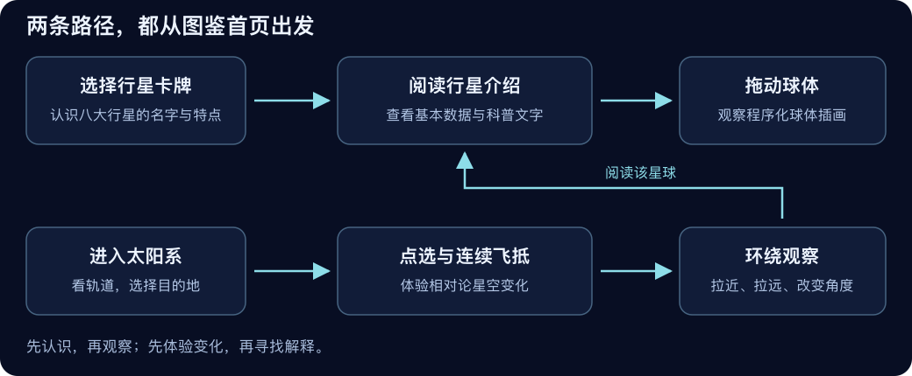

# 星际探索局：产品介绍与设计逻辑

你可以把这个项目理解成一间可以走进去的太阳系展厅。入口处是八张行星卡牌，帮助观众认出名字和特点；展厅深处是一段可操作的飞行，让观众看到“接近光速”怎样改变所见星空。

它的目标是把阅读、观察和实验连接起来。观众不必先理解公式，可以先看到变化，再带着问题寻找解释。

## 1. 给谁看，要让人带走什么

直接使用者是对宇宙有兴趣的青少年，也适合课堂演示、科普活动和个人探索。产品介绍文档面向项目接手者：即使没有编程背景，也应能说清楚产品想表达什么。

第一层学习目标是认识八大行星，知道它们有不同的大小、轨道周期、表面特征和环境。第二层是理解观察位置与运动状态会影响所见景象。第三层才是认识 β、光行差、多普勒和时间膨胀这些词。

这三层没有强制顺序。喜欢读的人可以停留在图鉴，喜欢操作的人可以先飞行，再通过“阅读该星球”回到介绍。

## 2. 为什么分成图鉴和飞行两个入口

图鉴适合比较和阅读：八张卡牌排列在同一个页面，中英文名称与一句话介绍帮助观众快速建立印象。打开卡牌后，内容集中于一颗行星，避免同时出现过多信息。

飞行适合体验空间与变化：观众能看见轨道、选择目的地、观察镜头靠近，并比较开启与关闭相对论后的星空。

两个页面分开，也让文字阅读拥有更低的运行门槛。图鉴的 3D 增强失败时，仍可以用 CSS 示意球体和文字阅读；太阳系页面则依赖 WebGL 进行完整绘制。

## 3. 图鉴为什么这样设计

卡牌顺序按离太阳由近到远排列，这是观众容易理解的组织方式。中英文并列既方便识别，也便于后续阅读英文科普材料。每张卡牌只放一句最有辨识度的介绍，让首页承担“认识和选择”的任务。

阅读页采用“球体、名称、基本数据、两段介绍”的顺序。球体先吸引注意，数据负责建立大小和时间概念，文字再讲环境与特点。这样可以快速浏览，也可以停下来细读。

“自转一周”明确表示行星转完一圈的周期，避免把它与当地太阳从升起到再次升起的一天混淆。卫星数量附带核对时间，因为新观测会改变数字。

球体是程序绘制的插画，不是航天器照片。地球的陆地轮廓、气态行星的条纹和岩石表面的凹凸用来帮助辨认，不应被当作真实地形图。

## 4. 为什么不能按照真实比例画太阳系

真实太阳系中的空旷距离与行星尺寸相差很大。为了同时看到外行星轨道与地球，如果完全坚持同一比例，地球在屏幕上会小到难以辨认。

本项目选择“保留有用的关系，压缩不利于观看的尺度”。远行星仍比近行星远，大行星仍比小行星大，但距离和尺寸分别压缩。默认距离采用平方根映射，海王星约 30.07 AU 的参考距离缩成约 5.48 个显示单位，地球的参考距离仍对应 1。

这种处理类似地图把漫长路线放进一张纸。地图便于观察，却不能把屏幕上的厘米直接当作地面的米。这里的压缩也改变了显示轨道的形状，画面不是精确星历。

行星轨道相位参考开普勒模型，模拟时间被加速，初始位置人为散开。这样观众能看出不同公转节奏，又不必等待真实的数月或数年。自转动画同样服务于观察，不按真实自转周期播放。

## 5. 飞行为什么要连续，并在抵达后停留

瞬间切换能很快把行星放大，但会让人失去出发位置和目的地之间的联系。本项目用连续镜头保留接近过程，同时逐步改变星空，让观众能把视觉变化与飞行进度联系起来。

镜头采用缓入缓出：起飞和抵达较慢，中段较快。镜头方向平滑转向目的地，目标行星继续沿轨道运动。到达时从实际相机位置接入环绕观察，避免突然跳到另一个角度。

抵达后球体直径约占画面高度的四分之一。它足以看清纹理，又留出背景和文字空间。继续拖动可以环绕观察，滚轮改变距离，“阅读该星球”把体验引回科普内容。

## 6. 参数面板为什么默认收起

第一次进入页面时，观众只需要知道拖动、缩放和点选。β、距离幂指数和半径幂指数属于第二层探索，因此放在可展开的参数面板中。

最有教育意义的操作是对照：先开启相对论，再关闭，观察同一视角的星空；或者降低峰值 β，比较变化程度。参数面板提供的是实验入口，不是要求每位观众都完成的配置工作。

修改距离或尺寸会改变整个场景的显示规则，所以页面返回俯瞰，给观众一个稳定起点。飞行时长在下一次起飞时生效，避免途中修改导致镜头交接混乱。

HUD 是画面里的小型数据表，显示当前 β、γ、演示 Δτ 和前向蓝移倍数。它帮助观众把视觉变化与数字联系起来。窄屏下 HUD 与行星信息卡分开，避免相互遮挡。

## 7. 相对论飞行的项目特色

核心特色是让同一次飞行同时呈现三种相关变化：星光所见方向改变、颜色产生近似变化、亮度随方向变化。它们使用同一组速度与方向参数，而不是三段彼此无关的视觉动画。

项目还把“镜头朝哪里看”与“镜头向哪里移动”分开计算。连续转向目的地时，星空变化仍以移动方向为依据。这样让飞行视角与相对论观察之间的关系更清楚。

这是把既有物理规律变成可操作网页体验的设计与工程创新。产品没有提出新的相对论定律，也没有做“世界首创”的比较论证。详细说明见 [相对论飞行与背景星空](05-相对论飞行与背景星空.md)。

## 8. 怎样准确地向观众介绍

可以这样说：

> 这里有八大行星的科普图鉴，还有一个太阳系飞行演示。你可以选择一颗行星，连续靠近它；途中提高演示速度，观察星空方向、颜色和亮度怎样变化。我们用相对论公式计算星光的方向和多普勒因子，同时压缩太阳系的距离与尺寸，让它适合在网页上观察。

讲解时应补充：β 和镜头时长用于教学，有限距离行星没有进行完整相对论成像，程序插画也不是天文观测照片。保留这些说明，可以让观众知道自己学到了什么，也知道哪些结论不能从这个演示直接推出。
