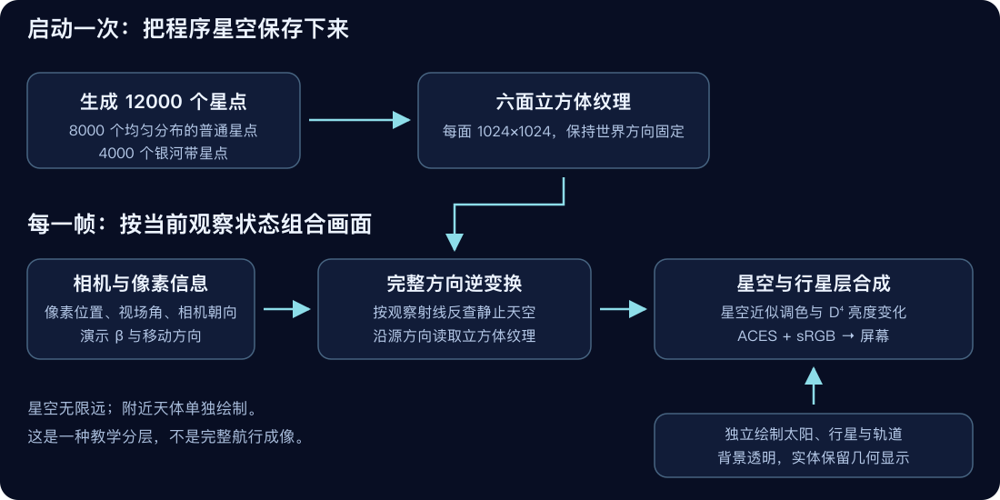

# 技术方案通俗说明：这个网页怎样做出来

这一篇从浏览器里的工作分工讲起。你不必懂编程，只需要知道“谁负责内容、谁负责外观、谁负责变化”，就能理解项目结构。

## 1. 技术栈是什么

技术栈指完成产品所用的一组工具。这里主要是浏览器已有的能力，加上一套帮助绘制三维画面的库。

| 名称 | 日常语言解释 | 在项目中的作用 |
|---|---|---|
| HTML | 页面骨架，告诉浏览器哪些地方是标题、按钮或画布 | 放置卡牌、阅读区、参数面板和画面容器 |
| CSS | 页面外观规则，类似排版和服装 | 深空配色、间距、文字、按钮、窄屏布局和图鉴背景 |
| JavaScript | 控制行为与计算的脚本 | 响应点选、切换阅读页、推进轨道和飞行、更新数据 |
| ES modules | 把一大段程序拆成可引用的小文件 | 让两页共用数据、视觉和计算模块 |
| Three.js 0.160.1 | 三维绘制工具库，相当于场景搭建工具箱 | 相机、球体、灯光、纹理与渲染目标 |
| WebGL | 浏览器使用显卡画三维图形的接口 | 将场景真正绘制成像素 |
| GLSL shader | 显卡上运行的小程序，逐点或逐像素处理画面 | 星点形状、相对论方向反查与最终合成 |
| Canvas 2D | 程序可以画线、色块和图案的一块画布 | 生成行星表面的纹理 |
| Node.js 22+ 与 Bash | 在浏览器之外运行检查的工具 | 执行 verify.sh 的语法、数学和资源检查 |
| Node.js 22+ 本地脚本或 Python 3 | 本地预览时的轻量网页服务 | 用 HTTP 让浏览器正确加载模块 |
| Git、GitHub、Actions、Pages | 版本记录、远端仓库、自动工作和网页托管 | 已启用：main 检查通过后自动发布 code/ |

Node.js 和 Python 不参与观众电脑上的线上运行。发布后，观众只需支持 JavaScript 和 WebGL 的浏览器。项目不需要 React、Vue、数据库、AI API、账号系统或后台服务。

Three.js 已放在 code/vendor 中并附带 MIT 许可证，固定为 0.160.1。页面从本地文件载入，避免运行时必须访问 CDN。package.json 目前只是检查命令的入口，没有等待安装的 npm 依赖。

## 2. 内容和画面为什么分开保存

行星的名称、介绍、配色和基础数据保存在 planets.js。轨道、参考半径和显示尺度保存在 solarsystem.js。两者通过稳定的行星 id 关联，例如 earth。

这样，改“地球的介绍”主要改内容文件，改“轨道怎样算”主要改几何文件。两个页面不会各自复制一份文字，也不会用两套略有差异的显示公式。

从编辑角度看，这类似把文章正文与排版模板分开。更新数字时不必重画界面；改配色时也不必重写物理计算。

## 3. 行星插画为什么不用外部照片

项目先在一张 1024×512 的画布上画图，再把这张图像贴到球体表面。可以把它想成给地球仪贴上一张展开的纸：图像的水平方向绕球体一圈，竖直方向从北到南覆盖。

气态行星用曲线条纹形成层次，木星增加一个示意大红斑；岩石行星用斑块和圆形图案表现质感；地球用海洋底色、椭圆陆地与淡云帮助识别。图案使用固定的伪随机序列，同一颗行星每次生成时保持稳定。

材质负责决定灯光怎样落在表面。项目使用同一纹理辅助表现凹凸，增加层次，但这些凹凸不是实测海拔。

这种做法让资源更容易随包交付，也形成统一视觉风格。代价是牺牲真实影像细节和准确地形。当前没有完整建模土星环、卫星或小行星带；科普文案提到的天体特征不代表全部已做成三维几何。

## 4. 卡牌为什么先“拍照”，阅读页为什么仍是三维

首页有八张卡牌。如果每张卡牌都持续绘制一套三维场景，显卡和浏览器需要反复工作。项目在启动时把每颗行星绘制成一张 320×320 的 PNG，这个过程叫“烘焙”。

卡牌随后显示这些图片，像在展板上贴八张照片。使用正交相机烘焙，使距离不额外改变大小感，便于形成一致的卡牌版式。

阅读页只展示一颗主要球体，因此保留实时三维绘制，让观众拖动它。临时拍照工具完成任务后被释放，正式绘制器继续工作。两个用途共用贴图和材质，避免卡牌与阅读页风格分叉。

如果 3D 初始化失败，图鉴可以退回 CSS 渐变球体，文字和阅读流程仍然可用。太阳系页面承载完整三维实验，发生错误时则给出可读提示。

## 5. 太阳系画面分成哪几层

画面把附近的太阳、行星和轨道，与远处的恒星背景分开绘制。附近天体需要真实的相机距离、遮挡和光照；背景星空在本项目中被视为无限远，只需要方向。

启动时先把星空保存进六面立方体纹理。每一帧再绘制当前太阳系场景，并把星空按观察方向和演示速度变换后合成。这个分工让星空不必每帧重新画六遍。

“渲染目标”可以理解为显卡里的临时画纸。“后处理”就是在已经画好的内容上继续处理方向、亮度和颜色，最后送到屏幕。

合成时要知道哪些位置有行星、哪些位置应该露出星空。alpha 就是这个覆盖度：没有实体的地方为 0，实体按材质写入自己的覆盖度。若把整张临时画纸都当作完全不透明，背景会被遮住，这正是本轮修复的一处确定性问题。

## 6. 怎样防止高亮星空变成一片白色

接近光速时，前向星光的理论辐射亮度增益很大，超过普通屏幕能显示的范围。项目先尽量使用半浮点 HDR 目标，保留高亮数据，再通过 ACES 形式的色调映射压缩到屏幕范围。

HDR 类似一张能记录更多明暗层次的底片；色调映射类似把这张底片调整成屏幕可观看的图像。压缩后的画面不是原始辐射强度，屏幕也不可能把几千倍亮度直接照出来。

程序检查显卡扩展和实际 framebuffer 是否可用；半浮点目标失败时尝试 8 位目标。降级路径优先保持功能，但高光范围会缩小。输出颜色按 sRGB 编码一次，避免重复调整造成偏暗或失真。

## 7. 交互为什么既有球体点选，又有文字按钮

俯瞰时行星可能只有几个像素，直接点球体并不容易。因此项目提供跟随位置的中英文名称按钮，也支持在球体上点选。

球体点选通过 Raycaster 完成：程序从鼠标位置向场景发出一条虚拟射线，看它先碰到哪颗行星。短距离点按被视为选择，拖动则用来改变观察角度。

标签采用真正的按钮，卡牌采用链接，便于键盘聚焦与操作。屏幕外的标签隐藏，抵达后的选中标签放到球体下方，减轻对球体的遮挡。

## 8. 怎样知道它确实运行正常

检查分成两类。第一类在 Node.js 中运行，核对公式、模块、语法、资源和文档链接；第二类在真实浏览器中执行显卡程序，读取像素，并检查八颗行星抵达、环绕和图鉴导航。

数学测试通过，不能自动证明显卡画面正常。因此项目保留独立的 render-check.html。验证报告明确区分两类证据，并说明浏览器和手机的覆盖边界。

继续维护时，应按照 [HANDOFF](../HANDOFF.md) 的步骤建立 Git 版本记录，再由用户确认 GitHub 目的地和网页公开范围。产品代码只需静态托管，GitHub Pages 可以承担这一步；自动发布模板会先运行离线检查，再上传 code 目录。
